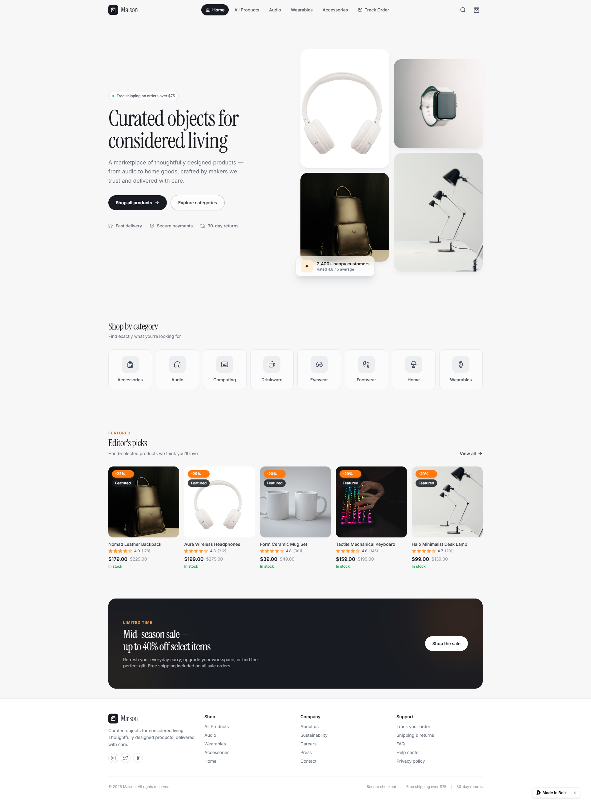

# Maison

Maison is a modern marketplace storefront built with React, TypeScript, and Vite. It uses Supabase for its product catalog, inventory, and guest orders.



## Features

- Browse featured products and shop by category
- Search products and view product details
- Add products to a persistent cart and adjust quantities
- Guest checkout with server-side price and stock validation
- Look up orders using the checkout email address
- Seed catalog with 20 products in 8 categories

Checkout currently creates orders with an `unpaid` payment status. Payment processing is not integrated.

## Requirements

- Node.js 20.19+ or 22.12+
- npm
- A Supabase project

## Getting Started

1. Install dependencies:

   ```sh
   npm install
   ```

2. Create a `.env` file in the project root with your Supabase project URL and anon key:

   ```dotenv
   VITE_SUPABASE_URL=https://your-project.supabase.co
   VITE_SUPABASE_ANON_KEY=your-supabase-anon-key
   ```

   Find these values in your Supabase project's API settings. The frontend uses the anon key; do not put a service-role key in this file.

3. Apply the SQL migrations in `supabase/migrations/` to your Supabase project, in timestamp order:

   - `20261102071706_create_ecommerce_schema.sql`
   - `20261102071827_seed_ecommerce_data.sql`
   - `20261102074203_create_place_order_function.sql`

   You can run each file in the Supabase SQL Editor. The migrations create the catalog and order tables, enable row-level security, seed the sample catalog, and create the `place_order` database function used at checkout.

4. Start the development server:

   ```sh
   npm run dev
   ```

   Open the local URL printed by Vite.

## Scripts

| Command | Description |
| --- | --- |
| `npm run dev` | Start the Vite development server |
| `npm run build` | Create a production build in `dist/` |
| `npm run preview` | Preview the production build locally |
| `npm run lint` | Run ESLint |
| `npm run typecheck` | Type-check the application |

## Tech Stack

- React 18 and TypeScript
- Vite
- Tailwind CSS
- Supabase JavaScript client and PostgreSQL
- Lucide React icons